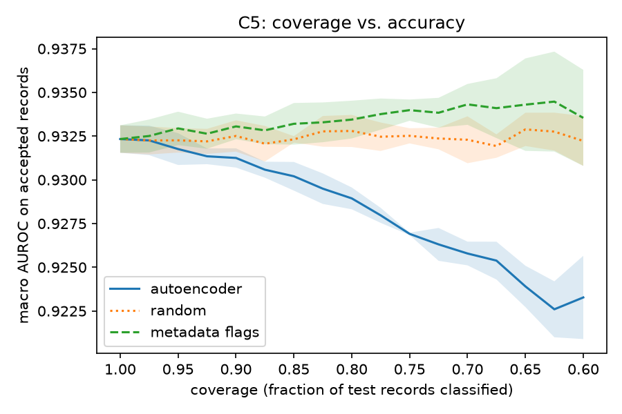
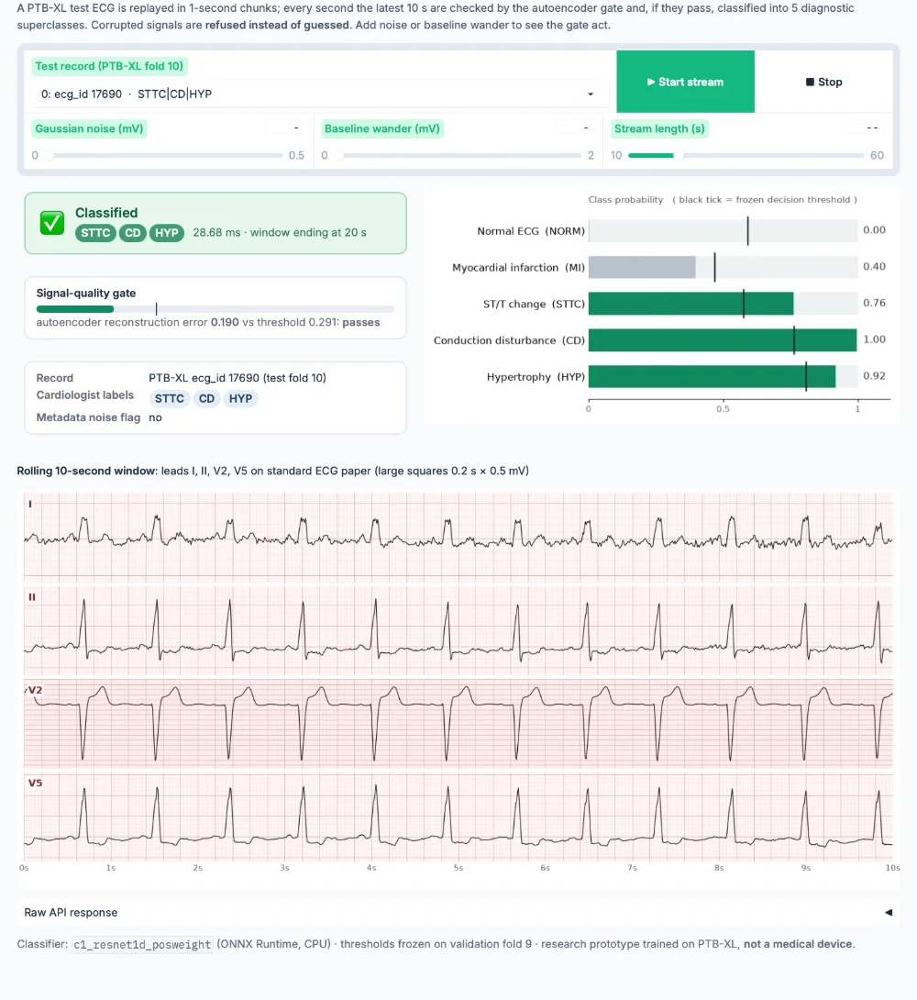
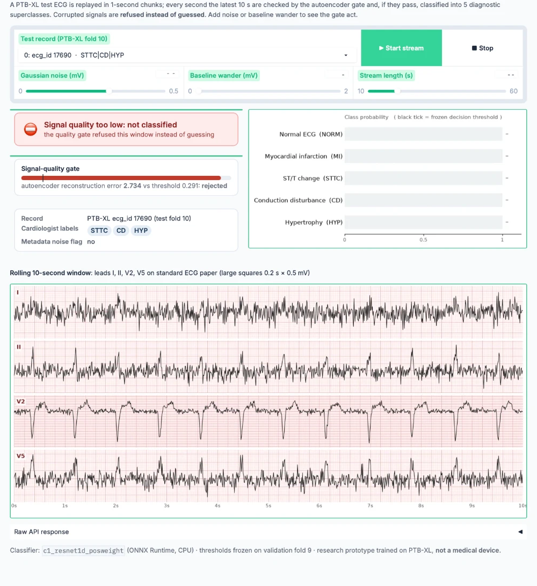

# Real-time ECG classification with a signal-quality gate (PTB-XL)

> **Result:** _TODO after the final runs: one sentence, e.g. "A 1D ResNet within the 20 ms CPU budget reaches X ± Y macro AUROC on PTB-XL fold 10 (benchmark ≈ 0.93); rejecting the 10% worst-reconstructed records raises it to Z at 90% coverage."_ Fill it in from `reports/tables/results.md`. Do not round in your favour.



A CPU-deployable multi-label classifier for the 5 PTB-XL diagnostic superclasses (NORM, MI, STTC, CD, HYP). It **refuses to classify corrupted signals instead of guessing**: an autoencoder trained only on clean ECGs scores each input, and records above a reconstruction-error threshold get `{"status": "low_quality"}` back.

**Questions**
1. Under a fixed CPU budget (20 ms p95 per 10 s record, batch 1, ONNX Runtime, 4 threads), which architecture is most accurate: 1D ResNet, BiLSTM or Transformer?
2. Can an autoencoder trained only on clean ECGs flag noisy recordings (judged against PTB-XL's own noise annotations), and how much does rejecting them help on what remains?

## How to run (3 commands)

```bash
make setup data          # install, download PTB-XL 1.0.3 (1.7 GB), build the 100 Hz cache
make baseline c1 c2-sweep c2 c3 ae   # all experiments, 3 seeds each (GPU for c1-c3/ae)
make c4c5 c6 latency report export serve   # analysis, tables, ONNX export, API on :8000
```

`make test` runs the unit and integration tests on synthetic data (no download needed). The data only needs to exist where training runs. The latency steps (`c2-sweep`, `latency`, `serve-latency`) need no data but must run on the deployment-class CPU (the laptop). See [Compute](#compute).

## Results

All numbers are on fold 10 (test) as **mean ± std over 3 seeds**. Thresholds for F1 and MI sensitivity are chosen on fold 9 and frozen. The table below is regenerated by `make report` from `runs/*/seed*/metrics.json`.

<!-- RESULTS:START -->
| exp   | run                         | model           |   seeds | macro AUROC   | macro F1      | MI sens @90% spec   | params (M)   | CPU p50 / p95 (ms)   | size (MB)   |
|:------|:----------------------------|:----------------|--------:|:--------------|:--------------|:--------------------|:-------------|:---------------------|:------------|
| B0    | b0_features_hgb             | features+hgb    |       3 | 0.924 ± 0.001 | 0.746 ± 0.003 | 0.747 ± 0.007       | -            | -                    | -           |
| B0    | b0_features_logreg          | features+logreg |       3 | 0.891 ± 0.000 | 0.692 ± 0.000 | 0.609 ± 0.000       | -            | -                    | -           |
| C1    | c1_bilstm                   | bilstm          |       3 | 0.931 ± 0.001 | 0.753 ± 0.009 | 0.797 ± 0.005       | 2.14         | 30.1 / 32.6          | 8.5         |
| C1    | c1_bilstm_posweight         | bilstm          |       3 | 0.931 ± 0.002 | 0.757 ± 0.003 | 0.796 ± 0.012       | 2.14         | 30.5 / 32.6          | 8.5         |
| C1    | c1_resnet1d                 | resnet1d        |       3 | 0.931 ± 0.001 | 0.749 ± 0.004 | 0.804 ± 0.020       | 6.31         | 8.6 / 8.8            | 25.2        |
| C1    | c1_resnet1d_bandpass        | resnet1d        |       3 | 0.930 ± 0.006 | 0.748 ± 0.010 | 0.790 ± 0.023       | 6.31         | 8.6 / 8.9            | 25.2        |
| C1    | c1_resnet1d_posweight       | resnet1d        |       3 | 0.932 ± 0.001 | 0.751 ± 0.002 | 0.799 ± 0.020       | 6.31         | 8.6 / 8.9            | 25.2        |
| C1    | c1_transformer              | transformer     |       3 | 0.914 ± 0.001 | 0.731 ± 0.002 | 0.701 ± 0.007       | 0.84         | 1.0 / 1.3            | 3.4         |
| C1    | c1_transformer_posweight    | transformer     |       3 | 0.914 ± 0.000 | 0.728 ± 0.001 | 0.701 ± 0.010       | 0.84         | 1.0 / 1.3            | 3.4         |
| C2    | c2_bilstm                   | bilstm          |       3 | 0.929 ± 0.001 | 0.754 ± 0.003 | 0.796 ± 0.006       | 1.21         | 18.8 / 19.6          | 4.8         |
| C2    | c2_resnet1d                 | resnet1d        |       3 | 0.930 ± 0.001 | 0.748 ± 0.002 | 0.784 ± 0.007       | 11.93        | 16.7 / 18.8          | 47.7        |
| C2    | c2_transformer              | transformer     |       3 | 0.922 ± 0.000 | 0.745 ± 0.002 | 0.746 ± 0.010       | 6.41         | 4.0 / 4.3            | 25.7        |
| C3    | c3_b0_features_hgb_frac0.1  | features+hgb    |       3 | 0.900 ± 0.001 | 0.702 ± 0.001 | 0.641 ± 0.014       | -            | -                    | -           |
| C3    | c3_b0_features_hgb_frac0.25 | features+hgb    |       3 | 0.912 ± 0.001 | 0.725 ± 0.001 | 0.697 ± 0.009       | -            | -                    | -           |
| C3    | c3_b0_features_hgb_frac0.5  | features+hgb    |       3 | 0.918 ± 0.001 | 0.736 ± 0.004 | 0.740 ± 0.014       | -            | -                    | -           |
| C3    | c3_bilstm_frac0.1           | bilstm          |       3 | 0.900 ± 0.001 | 0.700 ± 0.000 | 0.653 ± 0.011       | 2.14         | -                    | -           |
| C3    | c3_bilstm_frac0.25          | bilstm          |       3 | 0.915 ± 0.000 | 0.726 ± 0.003 | 0.747 ± 0.013       | 2.14         | -                    | -           |
| C3    | c3_bilstm_frac0.5           | bilstm          |       3 | 0.924 ± 0.002 | 0.744 ± 0.006 | 0.791 ± 0.021       | 2.14         | -                    | -           |
| C3    | c3_resnet1d_frac0.1         | resnet1d        |       3 | 0.894 ± 0.007 | 0.697 ± 0.011 | 0.615 ± 0.045       | 6.31         | -                    | -           |
| C3    | c3_resnet1d_frac0.25        | resnet1d        |       3 | 0.915 ± 0.000 | 0.728 ± 0.001 | 0.725 ± 0.003       | 6.31         | -                    | -           |
| C3    | c3_resnet1d_frac0.5         | resnet1d        |       3 | 0.926 ± 0.001 | 0.744 ± 0.004 | 0.767 ± 0.006       | 6.31         | -                    | -           |
| C3    | c3_transformer_frac0.1      | transformer     |       3 | 0.871 ± 0.001 | 0.663 ± 0.003 | 0.542 ± 0.010       | 0.84         | -                    | -           |
| C3    | c3_transformer_frac0.25     | transformer     |       3 | 0.893 ± 0.001 | 0.693 ± 0.001 | 0.628 ± 0.012       | 0.84         | -                    | -           |
| C3    | c3_transformer_frac0.5      | transformer     |       3 | 0.904 ± 0.001 | 0.714 ± 0.002 | 0.667 ± 0.011       | 0.84         | -                    | -           |

**Quality gate (C4)**, test AUROC of reconstruction error vs. metadata noise flags: 0.616 ± 0.002 (3 seeds)

**Selective classification (C5)**, test macro AUROC on accepted records:

| reject   | coverage   | autoencoder   | random        | metadata_flags   |
|:---------|:-----------|:--------------|:--------------|:-----------------|
| 0%       | 100%       | 0.932 ± 0.001 | 0.932 ± 0.001 | 0.932 ± 0.001    |
| 5%       | 95%        | 0.932 ± 0.001 | 0.932 ± 0.001 | 0.933 ± 0.001    |
| 10%      | 90%        | 0.931 ± 0.001 | 0.932 ± 0.001 | 0.933 ± 0.001    |
| 20%      | 80%        | 0.929 ± 0.001 | 0.932 ± 0.001 | 0.933 ± 0.001    |
<!-- RESULTS:END -->

How to read it:
- **B0 rows come first on purpose.** They are the strongest simple baseline: handcrafted features (lead statistics, Welch band powers, RR features, per-lead median beat) with gradient-boosted trees. A deep model only counts as an improvement if it beats B0 by more than the seed std.
- **"Matches the benchmark"** means within ~0.01 of the ≈0.93 macro AUROC that Strodthoff et al. (2021) report for the best CNNs on the superdiagnostic task.
- **C2** rows are the largest variant of each architecture under 20 ms p95 (`reports/tables/c2_latency_sweep.csv` holds the whole sweep). The answer to Q1 is the best C2 row.
- **C3** (data efficiency): `c3_<arch>_frac{0.1,0.25,0.5}` plus the C1 row for 100%.
- **C4/C5** (Q2): gate AUROC per noise type is in `reports/tables/c4_gate_auroc.csv`, and the coverage curve is the figure above. Random rejection at the same coverage is the control. Rejecting by the metadata flags themselves is an oracle the deployed system doesn't have.
- **C6** robustness curves: `reports/figures/c6_robustness.png` (Gaussian noise, baseline wander, lead loss, in mV), with the gate's rejection rate on the second axis.
- **Ablations:** `*_posweight` (per-class `pos_weight` in BCE) and `c1_resnet1d_bandpass` (0.5–40 Hz filter).

Deployment numbers (`make export` → `reports/tables/serving_latency.json`): p50/p95 for the gate + classifier pipeline, ONNX size in MB, and requests/sec from `make loadtest`.

## Failure analysis

_TODO after the final runs. Generate with `make failures` (writes `reports/tables/failures_<run>.md` and `reports/figures/failures_<run>_mi.png`) and summarise here with concrete ecg_ids._ Questions to answer:

- **Which class is weakest and why?** HYP has the fewest positives (~2.6k) and is defined largely by voltage criteria that 100 Hz standardization partly removes. Check its per-class AUROC and FN list.
- **MI misses:** at the frozen 90%-specificity threshold, which MIs are missed? Are they inferior vs. anterior? Old vs. acute (look at the SCP codes of the ecg_ids)? Are they co-labelled with CD (bundle branch block masks ST changes)?
- **Does the gate reject the right things?** List flagged records the gate *accepts* and clean records it *rejects*. The PTB-XL noise columns are themselves incomplete human annotations, so some "false" rejections may be genuinely noisy signals.
- **Slices:** the sliced table (noise flag, age band, sex, number of labels) shows whether errors concentrate in multi-label or elderly patients.
- **Grad-CAM** (`make gradcam`, 10 true-positive MI cases): `reports/tables/gradcam_mi.json` reports *ST enrichment*, the share of CAM mass inside estimated ST windows (R+60…240 ms) divided by the share of time they cover. Above 1 means the model looks at ST segments more than chance.

## Limitations

- **Noise labels are weak ground truth.** The four noise columns were annotated inconsistently, so the gate AUROC is bounded by label quality, not only by the model.
- **The gate tests whether a signal looks like the clean training ECGs.** That is not the same as whether the classifier will be wrong. Rare but clean morphologies (e.g. paced rhythms) may be rejected, and a corruption that is easy to reconstruct may pass. The synthetic smoke test already showed weak sensitivity to flat-lined leads. A cheap rule-based pre-check (flat line, saturation, amplitude range) would complement it.
- **The latency budget depends on the hardware.** All latencies are measured on one laptop CPU (recorded in each CSV's `hardware` column). The C2 selection must be re-run for a different deployment CPU.
- **100 Hz only.** The 500 Hz records might help QRS-morphology classes (CD, HYP). We don't test that.
- **Multi-label thresholds** are tuned for per-class F1 on fold 9. They aren't calibrated probabilities, so a clinical deployment would need calibration and a threshold policy set with clinicians.
- **Single dataset, single country, single device family.** There is no external validation, so the numbers say nothing about other hospitals or wearable ECGs.
- This is a research prototype, **not a medical device**.

## Method summary

| | |
|---|---|
| Data | PTB-XL v1.0.3 (CC BY 4.0), 100 Hz, 12 × 1000 per record. Records without a diagnostic superclass are dropped, as in the benchmark protocol. |
| Splits | `strat_fold` 1–8 train / 9 val / 10 test (patient-wise). Standardization is fitted on train only, and evaluation reuses the checkpoint's statistics. |
| Training | Random 2.5 s crops with amplitude scaling, Gaussian noise, baseline wander and lead dropout. BCE-with-logits, AdamW, one-cycle, 50 epochs, batch 128, early stopping on val macro AUROC (patience 8). |
| Inference | Sliding 2.5 s windows (stride 1.25 s, 7 windows), probabilities averaged. The exported ONNX graph contains the windowing, so latency is per full record. |
| Models | `src/ptbxl_ecg/models/`: xresnet1d-style ResNet (6.3M), BiLSTM 2×256 (2.1M), patch Transformer 4×128 (0.84M), conv autoencoder 12→128×125 (~0.4M). |
| Gate | Per-record reconstruction MSE. Threshold = 95th percentile of clean fold-9 errors (`gate.clean_percentile`). |
| Tracking | MLflow by default (`tracking.backend`: `mlflow` / `wandb` / `none`). `runs/<name>/seed<k>/` holds `config.yaml` (fully resolved), `metrics.json`, `preds.npz` and `best.pt`. |

## Deployment

```bash
make export                       # artifacts/{classifier,autoencoder}.onnx + meta.json, ONNX parity checked
make serve                        # or: make docker (serving image, linux/amd64)
curl -s localhost:8000/classify -H 'content-type: application/json' \
     -d "{\"signal\": $(python -c 'import json;print(json.dumps([[0.0]*1000]*12))')}"
make demo                         # Gradio: replays a test ECG in 1 s chunks, classifies the rolling 10 s window
make loadtest                     # locust, requests/sec on CPU
```

**Streaming demo** (`make demo`): a fold-10 ECG is replayed in 1 s chunks and the rolling 10 s window is gated and classified every second. Left: clean record ecg_id 17690, classified STTC, CD and HYP, matching the cardiologist labels (gate error 0.190 vs threshold 0.291). Right: the same record with 0.3 mV of added noise, refused instead of guessed (error 2.734).

| Classified | Refused by the quality gate |
|---|---|
|  |  |

`POST /classify` takes a 12 × 1000 array (mV, 100 Hz, leads I, II, III, aVR, aVL, aVF, V1–V6) and returns either
`{"status": "ok", "labels": [...], "probabilities": {...}, "reconstruction_error": ..., "latency_ms": ...}` or
`{"status": "low_quality", "message": "signal quality too low", ...}`. Malformed input gets a 422.

**Docker.** `serve/Dockerfile` is the serving side only: FastAPI, ONNX Runtime, the two exported models and `meta.json` (preprocessing statistics, per-class thresholds and the quality-gate threshold). There's no PyTorch and no training code in it, so the image is **303 MB** (linux/amd64, measured in CI) versus several GB for the training environment. `make docker` builds for `linux/amd64` by default, so an image built on an Apple Silicon Mac also runs on ordinary x86 servers (`DOCKER_PLATFORM=linux/arm64` runs it natively on the Mac). The port comes from `PORT` (default 8000).

**Verified in CI.** `.github/workflows/docker.yml` builds the image on every change to `serve/` or `artifacts/` and starts it. It then checks three responses: a clean fold-10 ECG (ecg_id 17690) must come back `ok` with exactly STTC, CD and HYP, the same record with 0.3 mV of added noise must be refused, and malformed input must get a 422. The job summary reports the image size. Its single-request timing is a cold smoke check on a shared runner, not a benchmark; latency figures come from `make serve-latency` and `make loadtest`. The request files are regenerated with `make api-fixture`, which first checks them against the exported models.

**Live demo.** `bash scripts/hf_space_bundle.sh` assembles a Hugging Face Docker Space (Space card in `deploy/huggingface/`, threads set for the free 2-vCPU tier). The same image then serves as a public API demo.

## Repo layout

```
pyproject.toml          installable package `ptbxl-ecg` (import name `ptbxl_ecg`)
configs/                one YAML per experiment (inherit: base.yaml); configs/generated/ is written by the C2 sweep
src/ptbxl_ecg/
  data/                 PTB-XL cache builder, splits, preprocessing, augmentation, test-time corruptions
  models/               ResNet1d, BiLSTM, Transformer, autoencoder, sliding-window wrapper
  evaluator.py          frozen-classifier API for downstream projects
  train.py              every training run (classifier | autoencoder | baseline), --seeds 0 1 2
  eval.py               evaluate a checkpoint, optionally under corruption
  baseline.py           B0 handcrafted features + gradient boosting
  latency.py            ONNX export + p50/p95 CPU benchmark
  export.py             serving artifacts
  experiments/          C2 sweep, C4/C5 gate, C6 robustness, Grad-CAM, failure analysis, aggregation
serve/                  FastAPI app, ONNX pipeline, Gradio demo, Dockerfile, locustfile (not in the wheel)
deploy/huggingface/     Space card for running the same image as a Hugging Face Docker Space
.github/workflows/      docker-smoke: build the image, POST real ECGs, assert the responses
notebooks/      analysis only (reads reports/), never training
reports/        figures/ and tables/ (generated)
tests/          unit + integration tests on synthetic data
```

## Using this package from another project

Project 3 uses this repo's data pipeline, normalization and classifier as its evaluator. It **installs** this repo instead of copying it, so there is exactly one PTB-XL loader:

```bash
pip install "ptbxl-ecg @ git+https://github.com/<you>/<this-repo>.git@v0.1.0"   # pin a tag, never a branch
```

```python
from ptbxl_ecg import Evaluator, load_cache, make_splits

X, Y, meta = load_cache("data/processed")     # build once: python -m ptbxl_ecg.data.ptbxl --root <ptb-xl dir> --out data/processed
split = make_splits(meta)                     # folds 1-8 / 9 / 10, identical to this repo's numbers
ev = Evaluator("c2_resnet1d_seed0.pt")        # checkpoint published from runs/ (e.g. a GitHub release asset)
ev.evaluate(X[split.test], Y[split.test])     # real test set
ev.evaluate(X_synth_mv, Y_synth)              # synthetic ECGs, same preprocessing, same frozen thresholds
```

Guarantees, each enforced by tests in `tests/test_public_api.py`:
- **Raw mV in.** The `Evaluator` applies the checkpoint's own train-fold standardization and bandpass flag, so callers can't normalize differently.
- **Versioned pipeline.** `PIPELINE_VERSION` is stamped into the cache's `info.json` and into every checkpoint. A mismatch raises `PipelineVersionError` instead of silently scoring through a different pipeline. Bump it whenever loading, label aggregation or preprocessing changes the numbers.
- **Split without YAML.** `make_splits(meta)` with no config uses `DEFAULT_DATA`, which a test keeps identical to `configs/base.yaml`.
- **Stable surface.** Everything Project 3 should touch is in `ptbxl_ecg.__all__`. Anything else is internal.

## Compute

Prototype locally (CPU/MPS) or on Colab. Final 3-seed sweeps run on a RunPod A40 or A100. PTB-XL is downloaded **on the pod only**:

| where | step | needs data |
|---|---|---|
| laptop | `make c2-sweep`, then commit + push `configs/generated/` | no |
| pod | `bash scripts/runpod.sh check`: tests, download, cache summary, baseline, 5-epoch sanity run | yes |
| pod | `bash scripts/runpod.sh train`: all GPU runs, 3 seeds, in the background | yes |
| pod | `bash scripts/runpod.sh analyze`: C4–C6, Grad-CAM, failures, ONNX export, tables | yes |
| laptop | copy back `runs/`, `reports/`, `artifacts/`, then `make latency serve-latency report`, `make serve`, `make loadtest` | no |

Rough size of the final run: B0 ×6 on CPU, C1 21 runs, C2 9, C3 27, AE 3, so ~60 GPU training runs of ≤50 epochs on ~17k records at 250 samples each. _Budget: TODO (fill in the per-project budget and the actual GPU-hours used from MLflow)._

## Data citation

Wagner, P., Strodthoff, N., et al. (2020). PTB-XL, a large publicly available electrocardiography dataset. *Scientific Data* 7, 154. PhysioNet, v1.0.3, CC BY 4.0.
Strodthoff, N., Wagner, P., Schaeffter, T., Samek, W. (2021). Deep learning for ECG analysis: benchmarks and insights from PTB-XL. *IEEE JBHI* 25(5).
